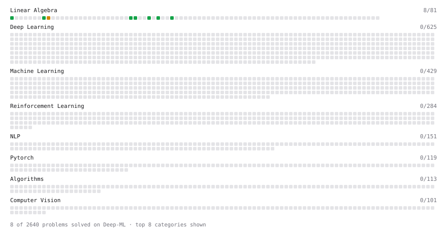

# Deep-ML

My machine learning practice from [Deep-ML](https://www.deep-ml.com). Every solution here was written by hand.

**7** solved · 6 problems · 0 labs · 1 math

[**Browse the interactive portfolio**](https://rolandrolandroland.github.io/deep-ml/) to replay this filling in over time.

## Problems

| | Difficulty | Solved | |
| --- | --- | --- | --- |
| [Calculate Cosine Similarity Between Vectors](https://www.deep-ml.com/problems/76) | easy | 2026-11-21 | [solution](problems/0076-calculate-cosine-similarity-between-vectors) |
| [Compute the Cross Product of Two 3D Vectors](https://www.deep-ml.com/problems/118) | easy | 2026-11-21 | [solution](problems/0118-compute-the-cross-product-of-two-3d-vectors) |
| [Dot Product Calculator](https://www.deep-ml.com/problems/83) | easy | 2026-11-21 | [solution](problems/0083-dot-product-calculator) |
| [Matrix-Vector Dot Product](https://www.deep-ml.com/problems/1) | easy | 2026-11-25 | [solution](problems/0001-matrix-vector-dot-product) |
| [Vector Element-wise Sum](https://www.deep-ml.com/problems/121) | easy | 2026-11-21 | [solution](problems/0121-vector-element-wise-sum) |
| [Vector Norms (L1/L2/L-inf) and the Frobenius Norm](https://www.deep-ml.com/problems/328) | easy | 2026-11-21 | [solution](problems/0328-vector-norms-l1-l2-l-inf-and-the-frobenius-norm) |

## Math

| | Difficulty | Solved | |
| --- | --- | --- | --- |
| [Matrix Multiplication](https://www.deep-ml.com/math-problems/10) | medium | 2026-11-25 | [solution](math/0010-matrix-multiplication) |

---

_This file is regenerated by Deep-ML on every push._
